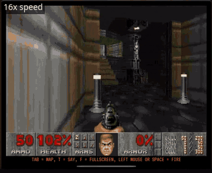
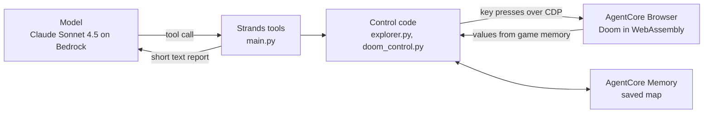
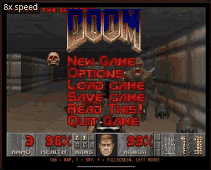

# DoomBedrockBot

An AI agent that plays the first level of Doom (E1M1) in a browser.
The agent runs on Amazon Bedrock AgentCore.
A language model selects the next move.
Python code does the steering, the aiming, and the map work.

The model never gets a screenshot.
All game state comes from the memory of the game, as plain numbers.



The agent finishes the level.
The preview plays at 16 times the real speed.
The [full video](docs/media/run-level-complete.mp4) has the real speed.

## How it works



One turn has these steps:

1. The model calls a tool, for example `explore()`.
2. The Python code reads the game memory and plans a path.
3. The Python code holds keys in the browser until the tool budget ends.
4. The tool returns one line of text to the model.
5. The model selects the next tool.

## The agent reads game memory, not images

Many game agents send a screenshot to a vision model on each step.
This agent does not.
No image goes to the model at any time.

The game is a WebAssembly build of Doom.
The full game state is in one memory buffer in the browser page, `wasmMemory.buffer`.
The Python code runs a small JavaScript function in the page with Playwright `page.evaluate`.
That function reads fixed positions in the buffer and returns a JSON object.

| Value | Where it comes from |
| --- | --- |
| Health, armor | Player structure at `HEAP32` index 236104, words +10 and +11 |
| Current weapon, owned weapons | Player structure, words +30 and +32 to +39 |
| Keycards | Player structure, words +19 to +21 |
| Ammo (bullets, shells, cells, rockets) | Player structure, words +41 to +44 |
| Player position and view angle | Player map object, words 3, 4 and 8 |
| Each monster and item: type, position, health, flags | Linked list of map objects, from the player map object |
| Monster is awake and hunts the player | The target pointer of the monster (word 30) points at the player |
| Walls, doors, windows, floor heights | `doom1.wad`, the level file that the game page serves |

The read is in `READ_JS` in [`doom_control.py`](DoomAgent/app/DoomAgent/doom_control.py).
The level file parser is in [`level_map.py`](DoomAgent/app/DoomAgent/level_map.py).

### What the model gets

The model gets text only.
This is real output of the `read_game_state` tool at the start of a run:

```text
Step 1:
  HP:100 ARMOR:0 WEAPON:pistol
  AMMO: bullets=50 shells=0 rockets=0 cells=0
  POS: (1056,-3616) VIEW ANGLE:90 (0=east, 90=north)
  WEAPONS: fist, pistol
  KEYCARDS: none
  MAP: 393 tiles known, 393 new, exit switch seen: not yet
  ENEMIES: none in view
  OBJECTS IN VIEW NOW (distance): barrel (435), armor bonus (709), barrel (711)
  REMEMBERED OBJECTS (seen earlier in this or a previous run, may be out of view): 3
    barrel [barrel] at (1312,-3264) dist=435
    armor bonus [armor] at (976,-2912) dist=709
    barrel [barrel] at (1152,-2912) dist=711
```

The `explore` tool returns one line:

```text
Exploring: 704 tiles known, heading to unexplored space at (1328,-3056). Call explore again.
```

### Why memory and not images

- **Exact values.** The position, the view angle and the health of each enemy are numbers, not estimates from pixels.
- **Speed.** One read is one `page.evaluate` call. The control loops read the state before and after each key press.
- **Small input for the model.** A report is some lines of text. An image for each step costs more tokens.
- **Hidden state.** The memory shows which monsters are awake. A frame does not show that.

This method has limits:

- The memory positions are valid only for this build of the game. A different build needs new positions.
- The game memory contains every object in the level. The code filters the objects by line of sight, as the next section explains.

### Sight is calculated, not rendered

The code does not look at the frame, so it calculates what the player can see.
`VisionMap.observe` casts 61 rays across a 90 degree field of view, up to 1024 map units.
Each ray stops at the first wall or door from the level file.
The tiles that a ray crosses become known tiles in the map.
The map has tiles of 32 map units.

The planner uses only known tiles.
The level file contains the full level, but the code uses it only as a model for sight and collisions.
The planner does not go to the exit switch before the switch was in view.
An object counts as seen only if it was in the field of view with a clear line of sight.

## Who decides what

### Decisions of the model

The model works in a loop that the system prompt in [`main.py`](DoomAgent/app/DoomAgent/main.py) describes.
It has six tools.

| Decision | How |
| --- | --- |
| Start the game | `start_doom_game()` |
| Continue to explore, or stop | `explore()` again, until a tool returns `LEVEL COMPLETE` or `DEAD` |
| Fight before it moves on | `attack_nearest_enemy()` when a tool reports enemies |
| Look at the state | `read_game_state()` each few turns |
| Look at the map | `look_at_map()` returns the known map as text |
| Get free when `explore()` makes no progress three times | `press_keys(keys, hold_seconds)` with keys and a time that the model selects |
| Change the weapon | `press_keys("weapon_3")` when the report lists the shotgun |

The model does not select a path, an angle, or a target.
The freedom of the model is small on purpose.
A model call takes seconds, and the game needs a decision many times each second.

### Work of the deterministic code

| Task | Rule in the code | Where |
| --- | --- | --- |
| Read the state | Fixed positions in the game memory | `doom_control.read` |
| Build the map | Ray cast from the player position and view angle | `VisionMap.observe` |
| Select the target | 1. A known health item if health is less than 50. 2. A known weapon that the player does not own. 3. The exit, if it was in view. 4. The nearest unexplored tile or unopened door. | `Explorer.plan` |
| Find the path | Dijkstra search on the known tiles, 8 directions | `Explorer.search` |
| Keep away from danger | Extra cost for narrow tiles. Floors that cause damage are used only if no other path exists. | `Explorer.moves` |
| Make the path shorter | Tiles in a straight clear line become one waypoint | `Explorer.waypoints` |
| Steer | Turn until the error is less than 6 degrees. Hold the turn key for a time in proportion to the error. | `doom_control.face` |
| Move | Walk near the target, run if the distance is 150 units or more | `Route.goto` |
| Open doors | Press use at the tile before a door. Press use if the player does not move. | `Explorer.run`, `Route.goto` |
| Select enemies | Awake, alive, nearer than 400 units, clear line of sight, and the player has ammo | `Route.threats` |
| Aim and shoot | Turn to the nearest threat within 3 degrees, then hold fire for 0.45 or 0.8 seconds | `Route.attack` |
| Give up on a target | After two shots with no damage, ignore the enemy for 6 seconds | `Route.attack` |
| Get free | Strafe left, then right. After a timeout, mark the tile as blocked and plan again. | `Route.goto`, `Explorer.bump` |
| Press the exit switch | Stand in front of the switch, face it, press use, then check that the level ended | `Explorer.press_switch` |
| Save the map | After each `explore()` call | `Explorer.save` |

`explore()` fights the enemies in view by itself.
`attack_nearest_enemy()` is for the model when it wants the enemies dead before it moves on.

## Map memory across runs

The agent keeps what it saw.
A later run starts with the map of the earlier runs.

The saved data contains:

- The known tiles (floor, wall, door, window).
- The objects that were in view, with type and position.
- The tiles that the player visited or found blocked.
- A flag that tells if the exit switch was in view.
- The number of runs.

[`map_store.py`](DoomAgent/app/DoomAgent/map_store.py) writes the data to AgentCore Memory as one event.
The payload is JSON, compressed with zlib and encoded as base64.
On start, the code lists the events of the session `map-E1M1` and uses the newest one.
Events expire after 90 days.
The memory has no strategies, so AgentCore does not extract long-term records from the events.

If the run has no memory ID, the code uses a local JSON file.
If a save or a load fails, the run continues without the map.

## Stack

| Layer | Technology | Role |
| --- | --- | --- |
| Model | Claude Sonnet 4.5 on Amazon Bedrock | Selects the next tool |
| Agent framework | Strands Agents | Agent loop, `@tool` functions, streaming |
| Runtime | AgentCore Runtime | Hosts `main.py` as a container, Python 3.12, HTTP |
| Browser | AgentCore Browser | Managed Chromium session with live view in the AWS console |
| Browser control | Playwright over CDP | Key presses and `page.evaluate` |
| Game | Doom in WebAssembly at [silentspacemarine.com](https://silentspacemarine.com/) | Shareware `doom1.wad`, level E1M1 |
| Map memory | AgentCore Memory (events) | Keeps the map between runs |
| Deployment | AgentCore CLI with CDK | `agentcore.json` describes the runtime, the memory and the IAM policy |
| Packaging | Docker, `uv` | Container image with Python and Node.js |

## Repository layout

| Path | Content |
| --- | --- |
| `DoomAgent/agentcore/agentcore.json` | Runtime, memory and policy for the AgentCore CLI |
| `DoomAgent/app/DoomAgent/main.py` | Entry point, the six tools and the system prompt |
| `DoomAgent/app/DoomAgent/doom_control.py` | Memory read, steering, aiming, movement |
| `DoomAgent/app/DoomAgent/explorer.py` | Target selection, path search, the explore loop |
| `DoomAgent/app/DoomAgent/vision_map.py` | Calculated sight and the tile map |
| `DoomAgent/app/DoomAgent/level_map.py` | Parser for `doom1.wad` |
| `DoomAgent/app/DoomAgent/map_store.py` | Save and load of the map |
| `DoomAgent/app/DoomAgent/model/load.py` | Bedrock model ID |
| `DoomAgent/app/DoomAgent/doom-memory-policy.json` | IAM actions for the browser and the memory |
| `doom/doom_agent.py` | First version of the agent, kept as a reference |

## Run the agent

### Deploy to AgentCore

You need Node.js 20.12 or later, `uv`, and AWS credentials with access to Bedrock AgentCore.

1. Install the AgentCore CLI.

   ```bash
   npm install -g @aws/agentcore
   ```

2. Set your AWS account and region in `DoomAgent/agentcore/aws-targets.json`.
3. Deploy the project.

   ```bash
   cd DoomAgent
   agentcore deploy
   ```

4. Invoke the agent.

   ```bash
   agentcore invoke --prompt "Start playing Doom"
   ```

5. To watch the game, open the AWS console, then AgentCore, then Browser, then the live session.

### Local checks without AWS

These checks need Python 3.10 or later.
They do not call a model.

1. Download the level file to a folder outside of the repository.

   ```bash
   curl -o /tmp/doom1.wad https://silentspacemarine.com/doom1.wad
   ```

2. Go to the application folder.

   ```bash
   cd DoomAgent/app/DoomAgent
   ```

3. Run the checks that you need.

   | Command | What it does | Needs |
   | --- | --- | --- |
   | `python explorer.py /tmp/doom1.wad` | Plays two simulated runs. The second run uses the saved map. | Nothing |
   | `python vision_map.py /tmp/doom1.wad` | Checks the calculated sight | Nothing |
   | `python level_map.py /tmp/doom1.wad` | Checks the level file parser | Nothing |
   | `python map_store.py` | Checks save and load with a stub of the AWS client | `boto3` |
   | `python doom_control.py` | Plays the real game in headless Chromium on a fixed route | `playwright` |

## Recordings

The two recordings show the live view of the AgentCore Browser session while the agent plays.
The agent does not win each time.
Each run is different, because the timing of the key presses changes.

| Run | Result | Preview | Full video |
| --- | --- | --- | --- |
| Level complete | The agent finds the exit switch. The game shows 100% kills and a time of 6:42. |  | [run-level-complete.mp4](docs/media/run-level-complete.mp4) (6 min 26 s) |
| Death | An enemy kills the player after approximately 2 min 24 s. |  | [run-death.mp4](docs/media/run-death.mp4) (2 min 31 s) |

## First version

`doom/doom_agent.py` is the first version of the agent.
It finds walls only when the player does not move.
It calls the model only when the health decreases, to select a combat action.
The current agent in `DoomAgent/` replaces it.
